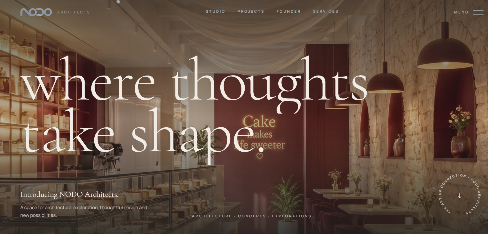

<div align="center">

# 🏛️ NODO ARCHITECTS
### *The Art of Connection — Where Every Space Finds Its Connection*

[](https://react.dev/)
[](https://vite.dev/)
[](https://tailwindcss.com/)
[](https://motion.dev/)
[](https://nodo-architects.vercel.app/)
[](https://nodo-architects.vercel.app/)

</div>

---

**Live URL:** https://nodo-architects.vercel.app/

## 📖 Project Overview
The official website of **NODO Architects**, an architecture and interior design studio founded by **Ar. Shana Rahmath**.

*NODO*, meaning connection, reflects the studio's belief that architecture is more than creating buildings. It is about bringing people, spaces and experiences together. The website follows that idea with an editorial layout, large serif typography and full-bleed photography. Motion ties the pages together and puts the studio's projects at the centre.

Built with **React + Tailwind CSS**, it is fully responsive and works on phones, tablets, laptops and large monitors.

---

## 📸 Visual Preview



---

## ✨ Design Features
* **🎬 Cinematic Motion:** An intro preloader, curtain transitions between pages, headings that reveal word by word, and images that unveil and move as you scroll.
* **🖱️ Interactive Details:** A custom cursor, magnetic buttons, project previews that follow the mouse, and a full-screen menu with image previews.
* **🎞️ Scroll Storytelling:** A horizontal Cake & Co. filmstrip, text that lights up as you scroll, cards that stack as you scroll, and counters that count up.
* **📐 Editorial Layouts:** An asymmetric grid with left, right and centred compositions, inspired by leading European and US architecture studios.
* **📱 Fully Responsive:** Adapts from large 4K monitors down to small mobile screens.
* **⚡ Optimized Performance:** Compressed WebP imagery, lazy loading and delivery through Vercel's Edge Network.

---

## 🗂️ Pages
| Page | Route | Description |
| :--- | :--- | :--- |
| **Home** | `/` | Hero, manifesto, featured project, work index, founder & services |
| **Studio** | `/studio` | The meaning of NODO, philosophy and values |
| **Founder** | `/founder` | Ar. Shana Rahmath — her story, work and contact |
| **Projects** | `/projects` | All projects with category filters and grid / list views |
| **Project Detail** | `/projects/:slug` | Case study pages: narrative, specifications, gallery |
| **Services** | `/services` | Architecture, interiors, planning and visualisation |
| **Approach** | `/approach` | The five-step design process |
| **Contact** | `/contact` | Inquiry form and studio contact details |

### Featured Projects
* **Cake & Co.** — Café interior
* **Maqbool Residence** — Malappuram, Kerala (2023)
* **Ayurveda Medical College** — Pantheerankavu, Calicut
* **Calicut Mobility Hub** — Malaparamba, Calicut

---

## 💻 Tech Stack
| Component | Technology |
| :--- | :--- |
| **Framework** | React 19 |
| **Build Tool** | Vite 8 |
| **Styling** | Tailwind CSS 4 |
| **Routing** | React Router 7 |
| **Animations** | Framer Motion |
| **Smooth Scroll** | Lenis |
| **Typography** | Cormorant Garamond & Manrope (Google Fonts) |
| **Hosting** | Vercel |
| **Deployment** | CI/CD via GitHub Integration |

---

## 🚦 Getting Started

### Prerequisites
* **Node.js** 20 or newer
* **npm**

### Local Setup
1. **Clone the repository:**
   ```bash
   git clone https://github.com/faizal08/nodo-architects.git
   ```

2. **Navigate to the directory:**
   ```bash
   cd nodo-architects
   ```

3. **Install dependencies and run:**
   ```bash
   npm install
   npm run dev
   ```

4. **Build for production:**
   ```bash
   npm run build
   ```

### ✏️ Editing Content
| What | Where |
| :--- | :--- |
| Studio email, phone, location | `src/data/site.js` |
| Projects (text, specs, images) | `src/data/projects.js` — add an entry to create a new project page |
| Images | `public/images/` |

---

## 🚀 Deployment
This project is automatically deployed via **Vercel**.

Any push to the `main` branch triggers an automatic build and production update.

**Live URL:** https://nodo-architects.vercel.app/

---

## 📬 Contact & Credits
| | |
| :--- | :--- |
| **Studio** | NODO Architects |
| **Architect** | Ar. Shana Rahmath — Founder & Principal Architect |
| **Studio Email** | nodoarchitects.studio@gmail.com |
| **Location** | Perinthalmanna, Kerala, India |
| **Developer** | Faizal |
| **Developer Email** | reachfaizal08@gmail.com |

<div align="center">

*NODO — Where Every Space Finds Its Connection.*

</div>
